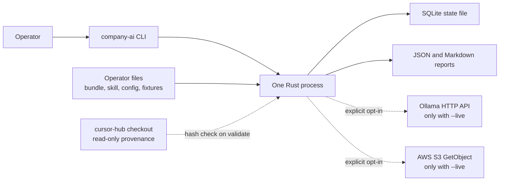

# company-ai-poc

A Rust reference implementation of governed AI workflows: explicit authorization, bounded execution, and auditable evidence, in one local process.

AI workers that touch real systems fail in ways ordinary scripts do not. A model can propose any operation, including one nobody approved. Its output can carry hostile text. It can loop, run long, or claim success it did not earn. Without explicit authorization, bounded execution, and recorded evidence, nobody can later say what was allowed, what was attempted, what was read, or why a report says what it says.

`company-ai` shows one small, testable answer to that problem:

- **Explicit authorization.** The worker only *proposes*. A deny-by-default broker decides, using an identity the runtime assigns, and issues a single-use `AuthorizedRead` for one target.
- **Bounded execution.** Model turns, tool proposals, provider attempts, duration, and sizes are budgeted, persisted, and checked between steps.
- **Auditable evidence.** Decisions, provider attempts, and evidence rows are recorded in SQLite. A report may only cite evidence from its own run.

This is a **reference implementation and consultancy credibility demo**. It is not a production enterprise agent platform, a sandbox, or a general workflow engine. The business scenario (diagnosing `demo-service-a`) is one example. See [Limitations](#limitations).

## What the demo does

An investigator receives a diagnostic event for `demo-service-a`, reads one policy-approved snapshot, and writes a local report. The report separates recorded facts, hypotheses, and missing information. That structure does not prove the diagnosis is true.

The default path uses a scripted worker and local fixture files. It needs no model, no network, no AWS account, and no `cursor-hub` checkout.

## Quickstart

Requirements: Rust toolchain **1.94.1 or newer** (the locked AWS SDK dependencies set this minimum).

```bash
git clone https://github.com/Kolzodev712/company-ai-poc.git
cd company-ai-poc
cargo build --locked
cargo run --locked -- demo --output var/demo
```

`demo` prints a `run_id:` line. Use that value as `RUN_ID`:

```bash
cargo run --locked -- inspect --database var/demo/state.sqlite --run RUN_ID
cargo run --locked -- replay  --database var/demo/state.sqlite --run RUN_ID
cargo run --locked -- export  --database var/demo/state.sqlite --run RUN_ID
```

`demo` always uses the scripted worker and the fixture service. It does not read `live.toml` and does not use the network. Running it again with the same event returns the original run and does not read the fixture again. Reports are written to `var/demo/reports/<run_id>.json` and `.md`. A recorded sample is in [examples/demo-run/](examples/demo-run/). Paths inside a config file are relative to the working directory.

**`cursor-hub` is optional.** `demo` and `run` do not read it. Only `validate --hub` needs a sibling checkout of [Kolzodev712/cursor-hub](https://github.com/Kolzodev712/cursor-hub) at the commit recorded in `governance/bundle.json`:

```bash
git clone https://github.com/Kolzodev712/cursor-hub.git ../cursor-hub
git -C ../cursor-hub checkout 14b375bbc77c0dfb15d03cb26f1231c3b5d5d0da
cargo run --locked -- validate --bundle governance/bundle.json --fixture-dir governance/fixtures --config examples/config.example.toml --hub ../cursor-hub
```

Without `--hub`, `validate` checks the bundle, skill, fixtures, and config, and prints `provenance: not checked`.

## Three behaviors you can see

### 1. A successful, authorized investigation

`cargo run --locked -- demo --output var/demo` ends with `status: succeeded`. The log shows `authorization ... allowed=true ... operation=diagnostics.read resource=demo-service-a`. The runtime stores the decision, the provider attempt, and one evidence row, then writes a report that cites that evidence.

### 2. A denied operation or invalid proposal

`demo` only runs the successful script. Denials are exercised two ways:

- **From the CLI.** Copy `examples/config.example.toml` to a private file, set `worker.script = "forbidden"`, point `runtime.database` and `runtime.reports_dir` at a scratch directory, and run:

  ```bash
  cargo run --locked -- run --config my-denied.toml --event examples/events/diagnostic-demo-service-a.json --worker scripted --service fixture
  ```

  The scripted worker proposes `demo-service-b`, which this identity may not read. The log shows `allowed=false reason=resource_not_allowed`, the fixture is not read, and the run ends `failed` with `missing_evidence` (exit code `1`). Other scripts in the same config field cover a spoofed identity (`spoof_identity`), a bucket override (`bucket_override`), malformed output (`malformed`), and an unknown tool (`unknown_tool`).
- **In tests.** [tests/acceptance.rs](tests/acceptance.rs) asserts these cases, including `forbidden_resource_does_not_call_the_adapter`, `identity_changes_permission_and_spoofing_does_not`, `bucket_override_is_rejected`, `malformed_unknown_invalid_and_oversized_fail`, and `timeout_denial_and_budget_do_not_succeed`. They check the recorded decision and that zero provider calls happened.

### 3. Inspecting evidence and history

`inspect` prints the run record: identity, policy version, bundle fingerprint, budget limits and use, every authorization decision with its reason, and evidence ids. `replay` reads the same recorded history from a read-only database handle and reports `external_calls: 0`. `export` writes the JSON and Markdown report paths. `inspect` also marks a run left in `running` as `interrupted`.

## Architecture at a glance

One local Rust process with four responsibilities: governance, a security broker, a tooling gateway, and a runtime. The solid arrows are the default fixture path. Dashed arrows do not run unless the operator names that live adapter and passes `--live`. A missing live setting is a setup error. The process does not fall back to fixtures.




More detail, without losing any of it:

- [docs/architecture-chart.md](docs/architecture-chart.md): module map, trust boundaries, type narrowing, sequence, lifecycle and budgets, local state, run selection, governance versus worker view
- [docs/architecture.md](docs/architecture.md): trust-boundary notes
- [docs/adapters.md](docs/adapters.md): extension points and the S3 permission needed
- [docs/limitations.md](docs/limitations.md): what a passing run does and does not show
- [docs/adr/](docs/adr/): decisions, including the move to Rust

## Limitations

This is a local reference implementation. Read these as distinctions, not fine print. The full list is in [docs/limitations.md](docs/limitations.md).

| Do not confuse | With | Why |
| --- | --- | --- |
| A scripted worker | A model | The default worker follows a fixed script. Ollama runs show model participation only when you opt in with `--live`. |
| A fixture run | A live run | Fixtures are local files. A passing fixture run shows no model and no cloud call. Live S3 and Ollama are opt-in and not exercised by the default tests. |
| Runtime labels such as `investigator` | Cryptographic workload identity | Labels come from config. Hashes, ETags, and fixture paths are recorded, not authenticated. |
| Scoped application authorization | Cloud IAM | The broker limits what this program asks for. It cannot grant a permission the AWS profile lacks, and it does not manage IAM. |
| A recorded audit trail in SQLite | Tamper-proof infrastructure | Hashes detect accidental change. They do not stop someone who can write the database or the fixture directory. |
| A structurally valid report | A true diagnosis | The report separates facts, hypotheses, and gaps. It does not prove any of them correct. |
| Replay | Re-execution | Replay reads history. It makes no model or provider call and does not reproduce model text. |
| One local process and one SQLite file | A distributed system | No distributed workers, scheduler, exactly-once delivery, mid-run policy revocation, or automatic resume of interrupted runs. |

Also: one real provider (S3) is integrated, so fixture versus S3 shows one operation contract, not two live providers interoperating.

## Relationship to cursor-hub

[cursor-hub](https://github.com/Kolzodev712/cursor-hub) is the methodological reference for this project: design-log practice, fault-first reporting, and system-orchestration evidence and authority rules. This repository adapts narrow excerpts and ideas from it. It is read-only here. It is not imported and not started at runtime.

`governance/bundle.json` records the cursor-hub commit and the SHA-256 hashes of the sources used. `validate --hub` re-checks them against a sibling checkout. Those hashes are provenance and are **not updated silently**: moving to a newer cursor-hub is a deliberate, reviewed change to the bundle. Hub follow-ups proposed in [docs/limitations.md](docs/limitations.md) are design-only and have not been applied to cursor-hub.

## Tests

The default tests use the scripted worker and fixtures only. No live provider is needed.

```bash
cargo fmt --all -- --check
cargo clippy --workspace --all-targets --all-features --locked -- -D warnings
cargo test --workspace --all-features --locked
```

The live smoke test is ignored unless you run it explicitly. An ignored test is not a passed live call.

## Other commands

Live modes are opt-in and need your own Ollama and AWS profile. They are not part of the default tests or demo.

```bash
cargo run --locked -- run --config examples/config.example.toml --event examples/events/diagnostic-demo-service-a.json --worker scripted --service fixture
```

```bash
cargo run --locked -- run --config live.toml --event examples/events/diagnostic-demo-service-a.json --worker ollama --service fixture --live
cargo run --locked -- run --config live.toml --event examples/events/diagnostic-demo-service-a.json --worker scripted --service s3 --live
cargo run --locked -- run --config live.toml --event examples/events/diagnostic-demo-service-a.json --worker ollama --service s3 --live
```

Check live settings without contacting a provider:

```bash
cargo run --locked -- live check --config live.toml --event examples/events/diagnostic-demo-service-a.json
```

Bounded smoke tests, only after `live check` is ready:

```bash
cargo run --locked -- live smoke --config live.toml --target ollama
cargo run --locked -- live smoke --config live.toml --target s3 --resource demo-service-a
```

Exit codes: `0` completed investigation or a valid check, `1` recorded failure, `2` setup, validation, or event conflict.

## Configure a live run

Copy `examples/live.example.toml` to `live.toml` (gitignored). Set:

- `worker.mode` to `ollama` and `worker.model` to a model already installed in Ollama. The default endpoint is `http://127.0.0.1:11434`. A non-local endpoint also requires `worker.allow_remote = true`.
- `service.mode` to `s3`, `service.s3.profile` to an AWS profile name, and `service.s3.region` to that profile's region.
- In a private copy of the bundle, replace `YOUR_BUCKET` for the alias you will read. The example object key is `diagnostics/demo-service-a.json`.

The profile needs `s3:GetObject` on that object only. See [docs/adapters.md](docs/adapters.md). This program does not create buckets, upload objects, or change IAM. The S3 client uses that named profile's credential file, not an ambient default account, and it does not fall back to fixtures.

## Restart an interrupted run

`inspect` marks a run left in `running` as `interrupted` and does not call a provider. Submitting the same event id returns that run. Start a deliberate new attempt with a new event id. Replay reads history and does not call a model or a provider.

## Layout

| Path | Role |
| --- | --- |
| `src/governance.rs` | Bundle loading and provenance checks |
| `src/broker.rs` | Deny-by-default decisions and `AuthorizedRead` |
| `src/gateway.rs` | The only `diagnostics.read` path |
| `src/runtime.rs` | Bounded event loop and completion checks |
| `governance/` | Mission, skill, policy, fixtures, cursor-hub provenance |
| `docs/architecture.md` | Trust-boundary notes |
| `docs/architecture-chart.md` | Detailed diagrams |
| `docs/limitations.md` | What a run does and does not show |
| `docs/adapters.md` | Extension points |
| `docs/adr/` | Decisions, including the move to Rust |

## Contributing, security, and community

- [CONTRIBUTING.md](CONTRIBUTING.md) for setup and high-scrutiny areas
- [SECURITY.md](SECURITY.md) to report a vulnerability privately
- [CODE_OF_CONDUCT.md](CODE_OF_CONDUCT.md)
- [ROADMAP.md](ROADMAP.md) (no dates, not a platform roadmap)
- [CHANGELOG.md](CHANGELOG.md)

## License

Licensed under the [Apache License, Version 2.0](LICENSE). See [NOTICE](NOTICE) for attribution, including MIT-licensed material adapted from cursor-hub.

Copyright © 2026 T.L.P. Arc Entertainment Ltd. Author and maintainer: Nikola Kolev.
