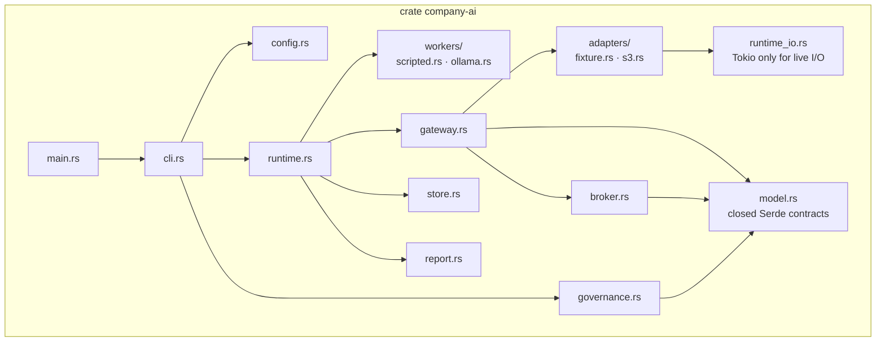
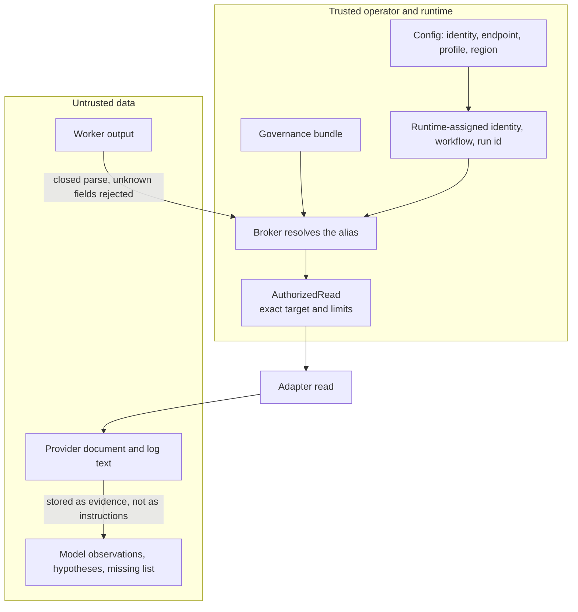
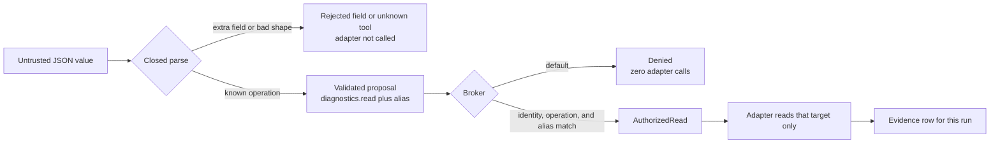
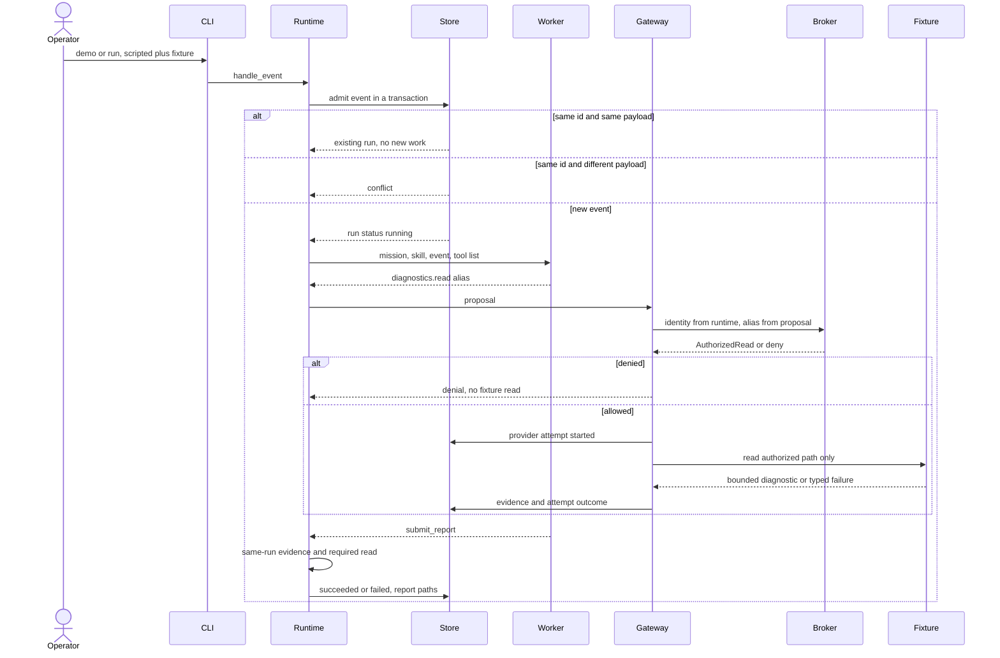
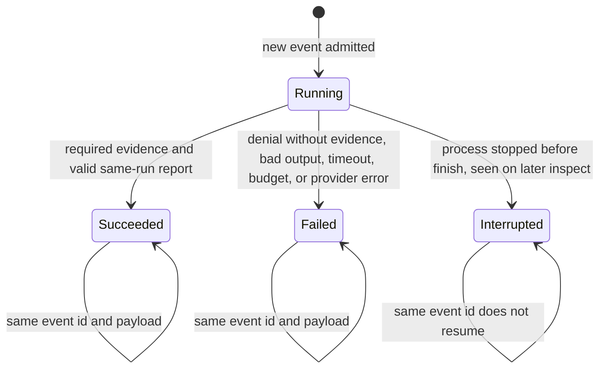
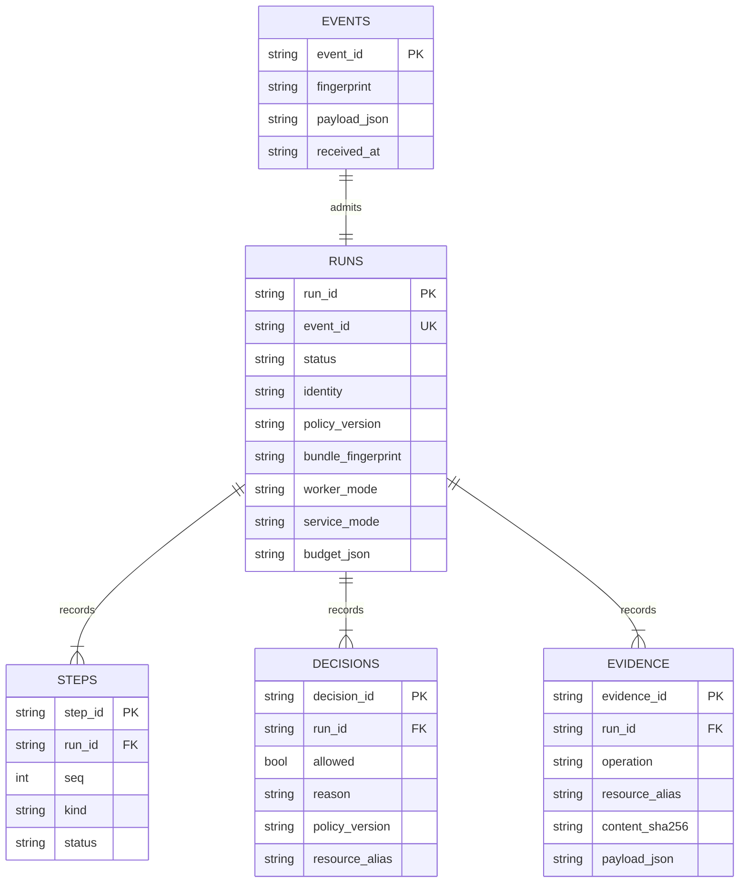
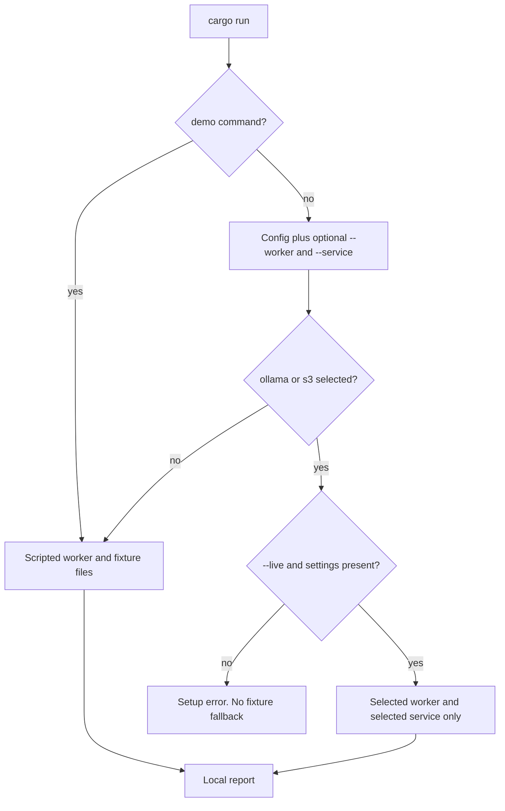
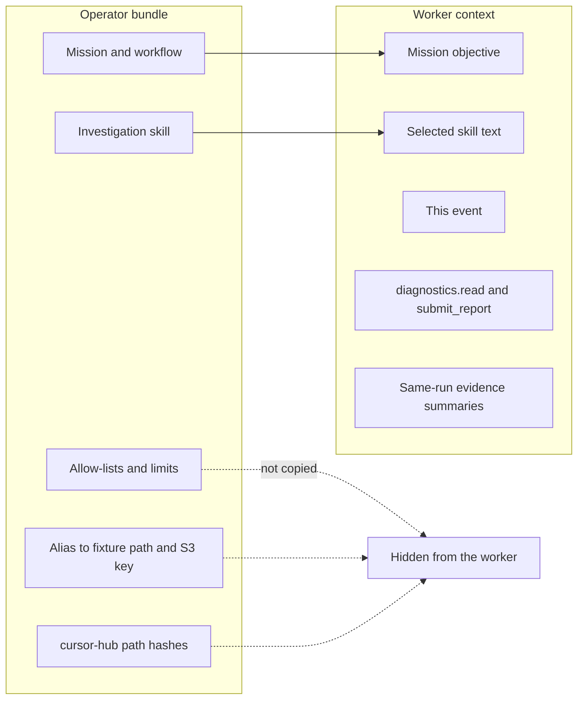

# Architectural charts

Detailed diagrams for `company-ai`. The system-context diagram stays in the [README](../README.md#architecture-at-a-glance). The sections below hold the module map, trust boundaries, type narrowing, sequence, lifecycle, local state, run selection, and governance-versus-worker views. Prose companions: [architecture.md](architecture.md), [adapters.md](adapters.md), [limitations.md](limitations.md), and [adr/](adr/).

### 1. Module map

| Module | Owns | Does not own |
| --- | --- | --- |
| Governance | Load and check the versioned bundle, skill hash, fixture containment, hub provenance | Permission decisions during a run |
| Security broker | One deny-by-default decision and, when allowed, one `AuthorizedRead` | Credentials, cloud IAM, reusable tokens |
| Tooling gateway | Validate, authorize, enforce limits, call the adapter, record the attempt | Direct model or provider calls from the worker |
| Runtime | Event admission, worker loop, budgets, completion checks | Provider SDK types |
| Workers | Propose `diagnostics.read` or `submit_report` | Executing either one |
| Adapters | Read the authorized target, or return a typed failure | Choosing a different bucket, key, path, or credential |
| Store | Transactional SQLite history | Replay of model text or provider calls |

### 2. Trust boundaries

| Boundary | What crosses it | What cannot cross it |
| --- | --- | --- |
| Worker to gateway | A JSON proposal or final report | Identity, approval, policy, budgets, bucket, key, endpoint, role, credentials |
| Broker to adapter | `AuthorizedRead` for one alias | A later request, a broader prefix, another credential |
| Provider to runtime | Bounded diagnostic JSON | Policy rewrites, skill rewrites, budget increases |
| Operator to process | Bundle, skill, config, `--live` | A model-supplied replacement for those files |

Configured names such as `investigator` and `auditor` are runtime labels. They are not cryptographic workload identity. A content hash, an S3 ETag, or a fixture path is recorded and is not authentication.

### 3. Type narrowing on one tool call

`AuthorizedRead` is constructed only in the broker. The adapter trait accepts that type, not a raw alias and not a model-supplied bucket or key. The compile-time type does not replace the runtime checks: a denied alias, a spoofed identity field, and a bucket override are still tested.

### 4. Successful fixture sequence

`submit_report` stays inside the runtime. It is not a provider operation and it does not pass through the gateway.

### 5. Run lifecycle

A completion status requires the workflow checks. The worker saying the investigation is done is not enough. A new attempt is a new event id. Replay opens the database read-only and performs no model or provider call. It does not reproduce model text.

Budgets that end the loop, all persisted and checked between steps:

| Budget | What counts |
| --- | --- |
| Model turns | Each worker call |
| Tool proposals | Each proposal, including denials |
| Provider attempts | Each adapter read, including one transient retry |
| Duration | Checked between steps. Each live call gets a timeout capped by time remaining |
| Input and result size | Worker context and diagnostic bytes |

Authorization failures are not retried by the gateway. A transient read failure may be tried once more, and that second attempt counts against the same provider budget. SDK retries for S3 are disabled. Ollama is asked for a finite `num_predict`. Neither is a promise that a remote process stops at that instant.

### 6. Local state

The database is one regular, non-symlink file with this application's id. It is not a distributed log and it is not exactly-once delivery. Two commands should not share one database at the same time. Same-event admission is transactional, so a second caller sees the first run instead of starting another.

### 7. How a run is selected

Worker mode and service mode are independent.

| Worker | Service | What a success shows |
| --- | --- | --- |
| Scripted | Fixture | Workflow, policy, and local report. No model and no cloud call |
| Ollama | Fixture | The named model took part. The document is still a fixture |
| Scripted | S3 | GetObject for the alias's object. The worker is not a model |
| Ollama | S3 | That pair completed this workflow. It still does not prove an incident diagnosis |

### 8. Governance inputs versus worker view

The skill is a narrow investigation instruction adapted from cursor-hub fault-first reporting and system-orchestration evidence rules. Rust pack rules and the hub design workflow are developer guidance. They are not loaded into the worker and they are not a permission engine.

### 9. What this chart does not claim

- The process is not a sandbox for arbitrary code.
- Fixture identities are not authentication.
- A passing structural report is not a true diagnosis.
- Fixture versus S3 shows one operation contract. It does not show two live providers interoperating.
- Mid-run policy revocation, distributed workers, and automatic resume of an interrupted run are outside this version.
